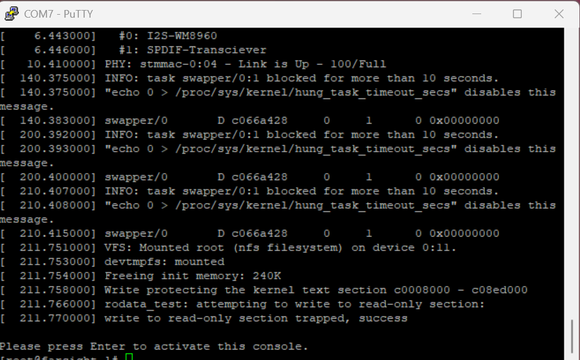
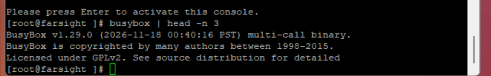
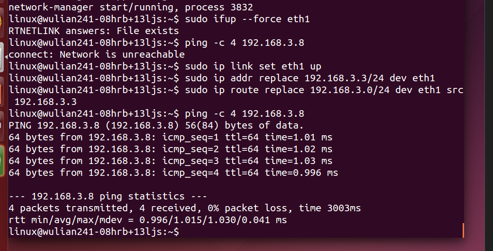

# 实验四 · BusyBox 根文件系统与 NFS 启动

归档日期为 2026-11-25（北京时间）。来源为本次实验聊天与用户提供的实际截图。

## 已验证结果

- Ubuntu 地址恢复到 eth1 的 192.168.3.3/24 后，可 ping 通开发板 192.168.3.8，4 发 4 收。
- NFS 服务重启各项显示 OK，导出目录为 /source/rootfs，带 rw、no_root_squash、no_subtree_check 选项。
- 开发板显示 `VFS: Mounted root (nfs filesystem)`。
- 显示 `Please press Enter to activate this console.`，按 Enter 后进入 `[root@farsight ]#`。
- 执行 `busybox | head -n 3`，实际显示 BusyBox v1.29.0。

## 本次排查与操作

### Windows 串口

PuTTY 打开 COM7 时曾提示 `Unable to configure serial port`。指导用户在设备管理器中选择电脑已有的 CH340 旧驱动，随后 COM7 成功打开并输出启动日志。此次具体安装后的驱动版本未独立复核。参考上次成功操作使用的版本为 3.3.2011.11。

PuTTY 使用 Serial、115200、Flow control None。以后串口号以设备管理器当时枚举结果为准。

### Ubuntu 网络

NetworkManager 版本为 0.9.8.8。该版列连接使用 `nmcli connection list`。图形编辑器保存按钮始终灰色，最终改用 /etc/network/interfaces 配置。

已写入以下内容。

```text
auto eth1
iface eth1 inet static
    address 192.168.3.3
    netmask 255.255.255.0
```

保留了原 eth0 的 192.168.100.192/24 配置。原文件中存在重复的 lo 段，本次未整理。NetworkManager.conf 中已有 `[ifupdown] managed=false`。

首次 `sudo ifup eth1` 后固定地址生效。后续地址或路由仍反复失效，`sudo ifup --force eth1` 曾恢复通信，但也曾报 `RTNETLINK answers: File exists`。重启 NetworkManager 未解决反复失效的问题。最后以下命令恢复当前通信，截图验证 4 发 4 收。

```bash
sudo ip link set eth1 up
sudo ip addr replace 192.168.3.3/24 dev eth1
sudo ip route replace 192.168.3.0/24 dev eth1 src 192.168.3.3
ping -c 4 192.168.3.8
```

这些 ip 命令修复运行状态。反复失效的原因以及 Ubuntu 重启后的稳定性仍待核验。

### NFS

```bash
sudo exportfs -rav
sudo service nfs-kernel-server restart
sudo exportfs -v
```

### 开发板启动参数

断电上电时在 PuTTY 输入空格打断倒计时，进入 FS6818#。命令列表确认支持 printenv、setenv、saveenv、boot。

原参数指向服务器 192.168.100.192、板卡 192.168.100.191。本次执行以下参数后启动成功。

```text
setenv ipaddr 192.168.3.8
setenv serverip 192.168.3.3
setenv bootargs root=/dev/nfs nfsroot=192.168.3.3:/source/rootfs console=ttySAC0,115200 init=/linuxrc ip=192.168.3.8:192.168.3.3::255.255.255.0::eth0:off
printenv bootargs
boot
```

原 bootcmd 从板载 MMC 加载内核，本次沿用。

```text
ext4load mmc 2:1 0x48000000 uImage;bootm 0x48000000
```

本次未执行 saveenv。断电后的持久保存仍待处理，应重新进入 U-Boot 设置并核对成功参数后保存。

## 截图证据







截图保留用户原图。启动图和版本图未同时展示 Ubuntu 个人主机名，报告提交前需要按老师要求与 Ubuntu 终端一起截图，并对指定启动提示画红圈。之前提到的 _install 截图本次尚未找到原件，仍需核对。

## 实验心得草稿

本次实验使用 BusyBox 1.29.0 制作嵌入式 Linux 根文件系统，通过 NFS 在 FS6818 开发板上启动。在操作过程中遇到了串口无法配置、Ubuntu 网卡地址失效和启动参数中的服务器地址不一致等问题。恢复串口和网络通信、修改启动参数后，开发板成功挂载根文件系统并进入 BusyBox 命令行。通过实验，我进一步理解了根文件系统、内核启动参数和 NFS 服务在开发板启动过程中的关系。

## 当前完成度

实际启动操作已验证成功。报告截图的主机名、红圈与 _install 原图待核对，心得待填入报告。网络持久稳定性和 U-Boot 参数保存仍需收尾。