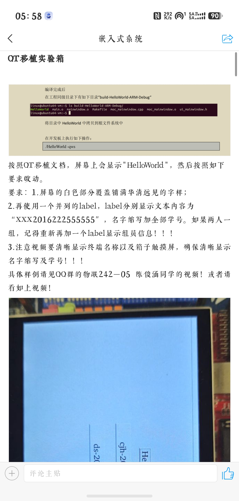
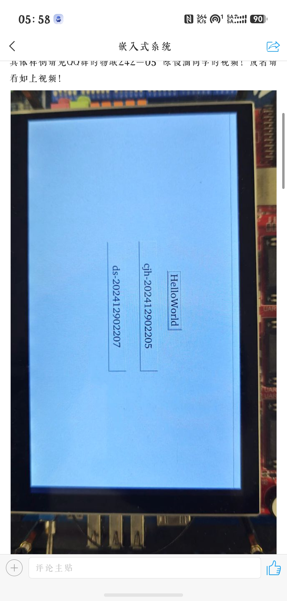

# 实验 5.5 Qt 移植验收要求

2026-11-25 用户补充课堂视频要求。本文件保留最初课堂要求；后续进度见末尾，不能据此认定视频验收已完成。

- 图形程序在实验箱触摸屏运行，界面背景白色区域按要求铺满“华清远见”字样。
- 两名组员分别使用独立 QLabel，每个显示姓名缩写与完整学号，界面中分开排列。
- 本组对应 hrb 与 202412902108、ljs 与 202412902113。缩写依据现有主机名 wulian241-08hrb+13ljs，填写界面时与用户确认大小写和分隔格式。
- 最终拍摄实物演示视频，清晰展示 Ubuntu 终端名称及实验箱触摸屏，姓名缩写和学号清晰可读。
- 到开发板运行成功、开始验收时主动提醒用户拍视频，并核对背景、两个独立 Label、两人信息和终端主机名。
- 参考照片中包含 HelloWorld 标签及两人独立信息标签。实施时结合课堂背景要求完成，保留 HelloWorld 展示。

## 阶段记录（北京时间 2026-11-26）

根据本聊天记录，Qt 移植及实验箱界面运行已完成，两个学号使用独立 Label。用户后续选择保留现有界面，不添加华清远见背景；原课堂要求仍保留供核对。尚未收到最终验收视频，不能标记提交完成。实际 Ubuntu 工程与二进制尚未导出到本归档。
