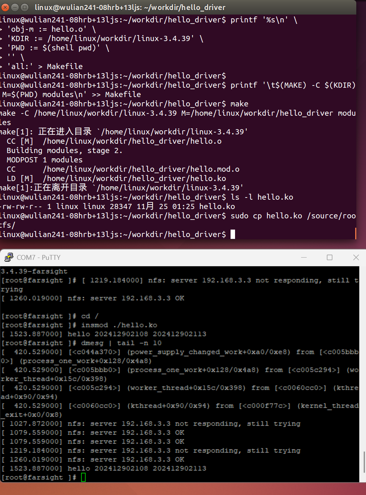
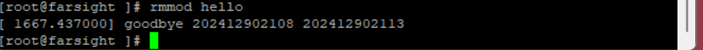
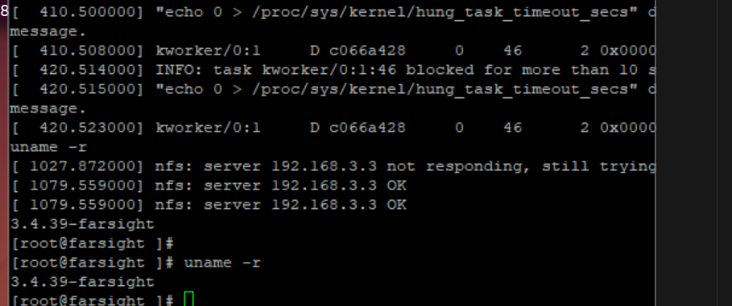

# 实验五 · 嵌入式 Linux 设备驱动

归档日期为 2026-11-25（北京时间）。根据用户上传报告和本次实际执行截图归档。

## 实验要求

在 ~/workdir/hello_driver 编写 hello.c 和 Makefile，编译生成 hello.ko，复制到 /source/rootfs，在开发板上动态加载和卸载。

- 生成 hello.ko 的 ls 截图占 20 分，要求红圈标出文件。
- 加载模块的打印效果截图占 30 分。
- 卸载模块的打印效果截图占 30 分。
- 实验心得占 10 分。
- 所有截图均需展示 Ubuntu 个人主机名，PuTTY 结果应与 Ubuntu 终端一起显示。

完整学号按用户提供的前缀和末两位组合为 202412902108、202412902113。Ubuntu 主机名为 wulian241-08hrb+13ljs。

## 环境与匹配结果

- FS6818 板卡运行 `uname -r` 实际输出 `3.4.39-farsight`。
- 使用源码目录 /home/linux/workdir/linux-3.4.39。
- include/generated/utsrelease.h 显示 3.4.39-farsight。
- .config 显示 CONFIG_LOCALVERSION="-farsight"、CONFIG_MODULES=y。
- 内核 Makefile 的 ARCH 为 arm，CROSS_COMPILE 为 /usr/local/toolchain/toolchain-4.5.1/bin/arm-none-linux-gnueabi-。
- 另一处 /home/linux/kernel-0.01/linux 未输出对应的生成版本和配置，本次未使用。

## 源码与构建

本目录 source/hello.c 和 source/Makefile 根据本聊天中发送的完整命令重建，便于复习和备份。实际 Ubuntu 构建通过用户截图验证。此次尚未从 Ubuntu 导出原始工程文件和 hello.ko 二进制文件。

驱动加载时打印以下文本。

```text
hello 202412902108 202412902113
```

驱动卸载时打印以下文本。

```text
goodbye 202412902108 202412902113
```

在 Ubuntu 执行的主要步骤如下。

```bash
mkdir -p ~/workdir/hello_driver
cd ~/workdir/hello_driver
# 在此目录保存 source/ 中的 hello.c 与 Makefile
make
ls -l hello.ko
sudo cp hello.ko /source/rootfs/
```

实际编译输出包含 CC [M] hello.o、MODPOST 1 modules 和 LD [M] hello.ko，ls 显示 hello.ko 大小为 28347 字节。

## 开发板加载验证

在 Windows PuTTY 的开发板 shell 中执行。

```sh
cd /
insmod ./hello.ko
dmesg | tail -n 10
```

实际打印 `hello 202412902108 202412902113`，加载成功。



## 开发板卸载验证

```sh
rmmod hello
```

实际打印 `goodbye 202412902108 202412902113`，卸载成功。之前曾误输入 remod，报命令不存在，改为 rmmod 后成功。



## NFS故障与恢复

实验中开发板出现 kworker blocked 告警和 `nfs: server 192.168.3.3 not responding`，Ubuntu eth1 无 IPv4 地址且 ping 显示 Network is unreachable。恢复 Ubuntu 地址和路由后，开发板打印 server 192.168.3.3 OK，并继续响应命令。



反复失效原因仍待核验，恢复步骤见同级实验四记录。

## 实验心得草稿

本次实验完成了嵌入式 Linux 内核模块的编写、编译、加载与卸载。使用与开发板内核版本一致的源码编译生成 hello.ko，通过 NFS 将模块传递到开发板，并使用 insmod 和 rmmod 验证加载、卸载时的打印功能。实验中遇到了 NFS 通信中断的问题，恢复 Ubuntu 网卡地址和路由后，开发板恢复正常。通过本次实验，我理解了内核模块初始化函数与退出函数的作用，掌握了简单驱动模块的基本开发和验证流程。

## 提交前待办

实际操作全部验证成功。报告①需给 hello.ko 加红圈。现有加载组合图已显示 Ubuntu 主机名，卸载原图只有 PuTTY，需补一张与 Ubuntu 主机名同框的卸载截图。重新获取卸载截图时，可再次 insmod ./hello.ko 后执行 rmmod hello。将三张合规截图和心得填入报告，补齐班级、姓名、学号及实际实验时间。

materials/ 保存用户提供的原始 .doc 报告。报告填写与提交尚未完成。